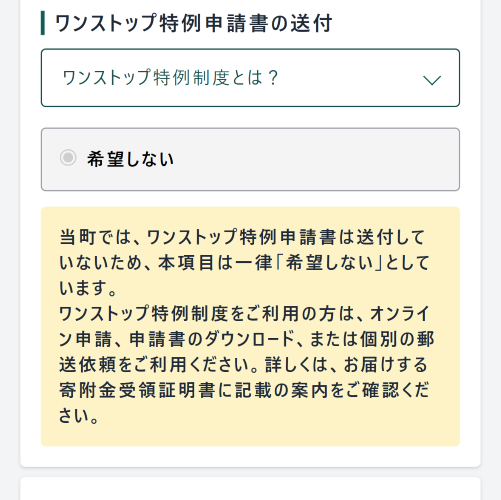

import { LinkCard, CardGrid } from '@astrojs/starlight/components';

###  ワンストップ特例申請書の郵送廃止に合わせた設定ができるようになりました  

【ふるさとズ】をご利用いただき、誠にありがとうございます。  
「店舗型ふるさと納税（R)『ふるさとズ』」運営事務局です。  
  
これまで寄附受付時に選択可能となっていた「ワンストップ特例申請書の送付」について、自治体さまの運用に合わせて、一律【希望しない】に設定が可能になりました。  

**◆設定画面◆**  
運営事務局側で設定の切り替えを行います。  
ご希望の場合は、お気軽に事務局までご依頼ください。  
案内文を追加することも可能です。  

**◆寄附画面◆**  

本リリースに関してご質問やご不明な点がございましたら運営事務局までご連絡ください。  
今後とも何卒よろしくお願い申し上げます。  
  

店舗型ふるさと納税（R)『ふるさとズ』運営事務局  
電話番号： 050-5794-3720  
メールアドレス：contact@furusatos.com  
営業時間：8時30分～17時30分  